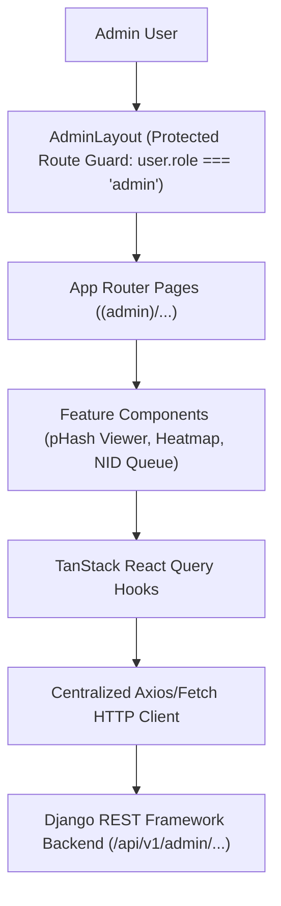

# Web Admin Agent Rules & Architecture Guide (rentbd_frontend/AGENTS.md)

> **Scope:** `RentBD/rentbd_frontend/`  
> **Framework:** Next.js (App Router) / React 19 & TypeScript  
> **Styling:** Tailwind CSS  
> **State Management:** TanStack React Query (`@tanstack/react-query`)  
> **Mapping & Heatmaps:** `@react-google-maps/api` & Leaflet  
> **Data Grids:** TanStack React Table (`@tanstack/react-table`)  

---

## 1. Modular Frontend Architecture

The Web Admin Dashboard is designed for high-density administrative operations, real-time moderation, and spatial visual intelligence.



### 1.1 Folder Structure & Conventions
```
src/
├── app/
│   ├── (admin)/               # Protected Admin Routes
│   │   ├── layout.tsx         # Admin Route Guard & Shell (Sidebar + Header)
│   │   ├── page.tsx           # Dashboard Analytics & Metric Aggregates
│   │   ├── ai-spam-detector/  # Perceptual Hash (pHash) Duplicate Queue
│   │   ├── heatmap/           # Demand vs. Supply Geospatial Heatmap
│   │   ├── nid-verification/  # Landlord NID & Live Selfie Adjudication
│   │   ├── properties/        # Property Moderation & Status Control
│   │   ├── rent-ledger/       # Revenue & Digital Rent Reconciliation
│   │   └── users/             # User Directory & Anti-Broker Registry
│   ├── login/                 # Super Admin Login Screen
│   ├── globals.css            # Tailwind Directives & Custom Color Tokens
│   └── layout.tsx             # Root Provider Shell (QueryClientProvider, AuthProvider)
├── components/
│   ├── layout/                # Sidebar, Header, Breadcrumbs, ThemeToggle
│   ├── ui/                    # Buttons, Badges, Modals, Stat Cards
│   └── maps/                  # Google Maps & Leaflet Heatmap Canvas
├── context/
│   └── auth-context.tsx       # JWT Token Management & Admin User State
└── lib/
    ├── api.ts                 # Axios / Fetch client with Bearer Token Interceptor
    └── utils.ts               # Formatting helpers (BDT Currency, Relative Dates)
```

---

## 2. Admin Intelligence Visualizations

### 2.1 Demand vs. Supply Geospatial Heatmaps (`/heatmap`)
- **Map Library:** Integrate `@react-google-maps/api` or Leaflet.
- **Data Layers:**
  - *Demand Layer (Red/Amber):* Renders heat clusters weighted by tenant search densities, saved alerts, and inquiry frequencies.
  - *Supply Layer (Blue/Green):* Renders pinned markers or clusters representing active, approved property listings.
- **Operations Insights:** Highlight high-opportunity mismatch zones (e.g., Mirpur 10 with 4,000 monthly searches but only 85 available listings).

### 2.2 Perceptual Hash (pHash) Duplicate Viewer (`/ai-spam-detector`)
- **Side-by-Side Comparison Cards:** Display the suspect listing alongside the original listing with side-by-side photo inspection.
- **Metrics Display:** Show Hamming distance score ($< 5\text{ indicates duplicate}$), matched image thumbnails, and broker account cross-links.
- **One-Click Adjudication:** Actions to `Approve Listing`, `Flag as Broker Duplicate`, or `Ban Host User Account`.

---

## 3. Strict Access Control & Protected Route Guards

- All administrative routes nested under `src/app/(admin)/` must be wrapped by `AdminLayout`.
- The layout must verify:
  ```typescript
  if (!user || user.role !== 'admin') {
    router.replace('/login');
  }
  ```
- Unauthenticated requests must redirect to `/login`.
- If an admin's JWT access token expires, the client interceptor must attempt refresh before gracefully clearing state and redirecting.

---

## 4. Testing & Verification Gate Protocol

Web agents must run linting and compile the production build prior to concluding any task:

```bash
cd rentbd_frontend

# 1. ESLint code quality & type sanity check
npm run lint

# 2. Production build compilation
npm run build
```

### Quality Acceptance Criteria:
- **Zero ESLint Errors/Warnings:** No unused variables, missing hook dependencies, or illegal `any` types.
- **Clean Build:** `next build` must generate optimized production routes without TypeScript compilation failures.
